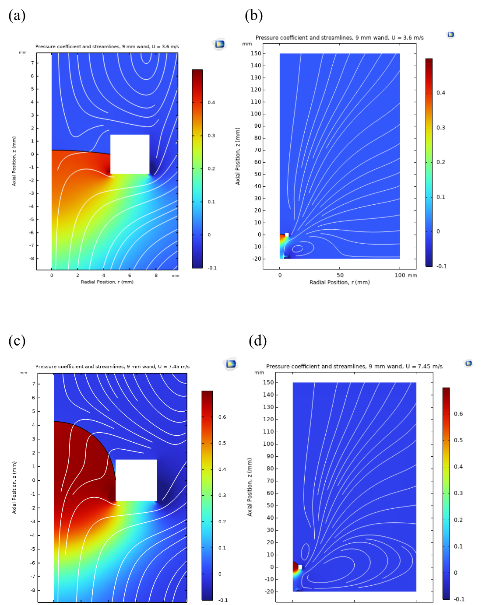
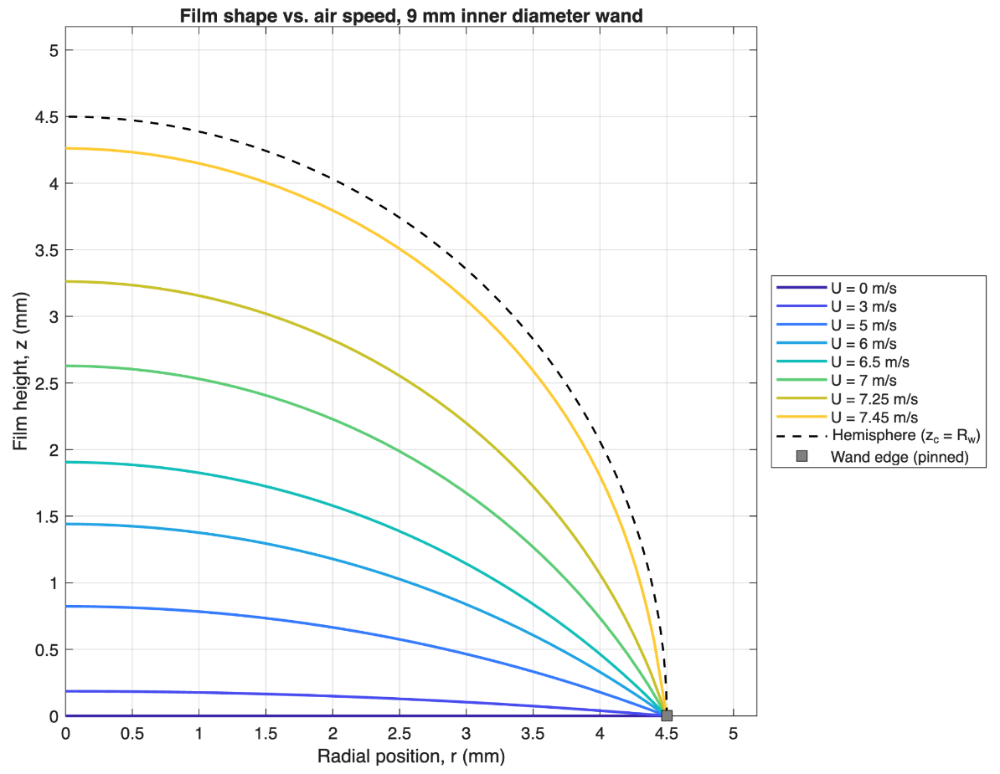
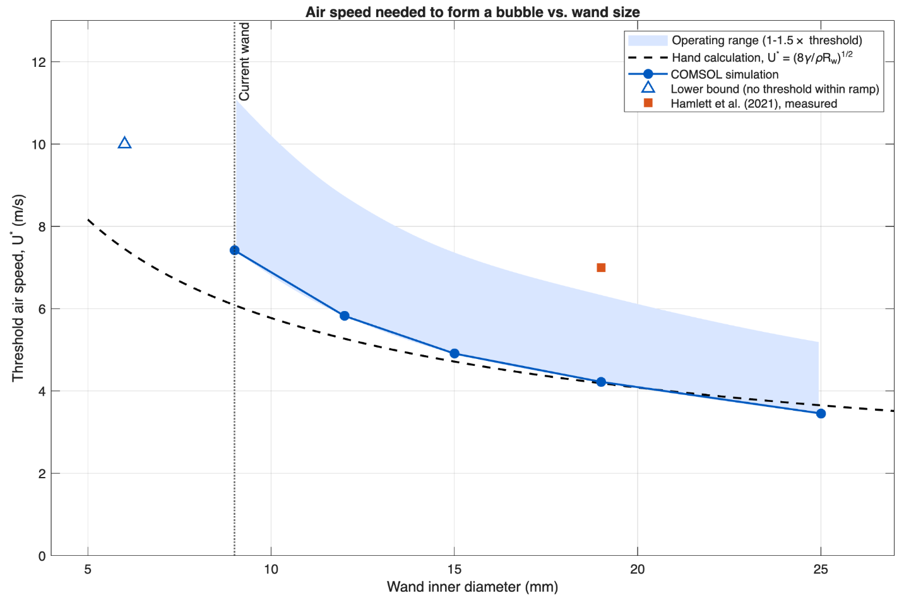
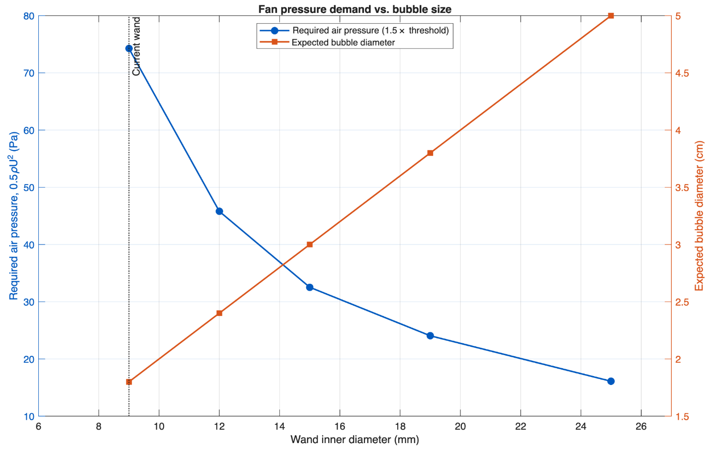

For our senior design project, my team is building a bubble machine for **Dr. Zigs**, a sustainable bubble company. Its founder, Paola Dyboski Bryant, wants pedal-powered bubbles that work while you ride. Existing bubble bikes are stationary show pieces, and handheld bubble machines can't mount to a bike. The hard part is motion: riding shakes the reservoir, and sloshing solution spills out of an open dip tray and foams up, which stops bubble production.

## Requirements

We turned the client's goals into ranked user needs: efficiency, safety, accessibility, durability, sustainability and adaptability. From those we set measurable targets:

| Requirement | Target | Threshold |
|---|---|---|
| Bubble rate | 0.5–1 bubbles/s | 3 bubbles/s |
| Average bubble size | 2 in | 0.5 in |
| Runtime without refill | 60 min | 30 min |
| Assembly time (new user) | 5 min | 15 min |
| Works in wind up to | 20 mph | 10 mph |
| Weight | 2 lb | 8 lb |
| Clamps bike tubes up to | 2.5 in | 0.75 in |

Because riders will include young children, we're designing with the ASTM F963 and ISO 8124 toy-safety standards in mind. That means enclosing moving parts, avoiding finger-sized gaps, and keeping motor stall torque low enough that a caught finger is safe.

## Prototype 1

The key design choice is to **never dip the wand**. The solution stays in a closed bottle, and a peristaltic pump draws it from the bottom and drips it onto the wand. A peristaltic pump keeps the fluid sealed inside its tube, can run at very slow flow rates and primes itself, and unlike pumps that cavitate, it doesn't foam the solution.

- A motor turns the bubble-wand "flower" through a 4:1 gear reduction, so every wand passes under the drip.
- A second motor drives a fan that blows the film off each wand. Vents let air into the enclosure.
- The reservoir is a reused Dr. Zigs bottle, kept tall and thin to limit sloshing.
- The laser-cut wood enclosure separates the electronics from the solution. For this first prototype it runs on a 5 V battery, so we could test bubble generation with a steady power source before adding pedal power.

**Results:** the prototype produced about 50 bubbles/s (estimated from slow-motion video) at 1.5–2 cm each. It weighs 750 g and measures 153 × 70 × 145 mm. It far exceeds the rate target, but the bubbles are smaller than the 2 in target.

## COMSOL: how much air does it take to blow a bubble?

Prototype 1's bubbles came out smaller than our target, and wand size and fan airflow are the main levers. The key unknown is: **for a given wand, how fast must the air be to form a bubble?** That sets bubble size, fan selection and power draw, which matters once the machine runs on limited bike power. Prototype 1 uses a 9 mm inner wand diameter, so I compared it against other sizes, first with a hand calculation and then with a COMSOL sweep.

**Hand calculation.** The film can resist a pressure of at most Δp = 4γ/Rw, reached when it bulges into a hemisphere spanning the wand (the factor of 4 is for the film's two surfaces). The jet pushes with dynamic pressure ½ρU², so a bubble forms above

U\* = √(8γ / ρRw)

With γ ≈ 0.025 N/m for a dish-soap solution and ρ ≈ 1.2 kg/m³, the 9 mm wand needs U\* ≈ 6.1 m/s. This assumes the full jet pressure acts uniformly on the film, and it ignores how the jet slows near the film and flows around the wand.

**COMSOL model.** A 2D axisymmetric Laminar Two-Phase Flow, Moving Mesh model in COMSOL 6.4: rotated about the axis, the square wand cross-section becomes a ring. The soap film is a zero-thickness interface with tension 2γ between two air domains, pinned at the wand's inner edge. The inlet speed ramps linearly (U = 10 m/s² × t), slowly enough that the film settles to the dome it would have at each constant speed. Since the model can't show a bubble detaching, the threshold is the speed at which the film center reaches 90% of the wand radius. I swept wand diameters of 6, 9, 12, 15, 19 and 25 mm. Refining the film from 3 to 40 elements changed the thresholds by less than 3%.

**Results.**

| Inner diameter | Simulated U\* | Hand calc. U\* |
|---|---|---|
| 9 mm (current) | 7.42 m/s | 6.09 m/s |
| 12 mm | 5.82 m/s | 5.27 m/s |
| 15 mm | 4.91 m/s | 4.71 m/s |
| 19 mm | 4.22 m/s | 4.19 m/s |

The hand calculation agrees with the simulation for larger wands, but smaller wands need progressively more air than it predicts: the jet slows sharply just before the film, so only about 45–60% of its dynamic pressure acts on it. For the 19 mm wand, the simulated 4.22 m/s is below Hamlett et al.'s measured 7 m/s, likely because the model assumes an ideal film, so the thresholds are best read as minimums. Varying the eddy viscosity from 50× to 200× air's changed the 9 mm threshold by −12% to +19% (and the 19 mm by +6%), so the model is most reliable for **comparing wand sizes**, not for exact air speeds.

**Design takeaway.** Required air speed rises steeply below 12 mm. At 1.5× the threshold, the 9 mm wand needs about **74 Pa** of fan pressure, versus 46 Pa at 12 mm, 33 Pa at 15 mm and 24 Pa at 19 mm, and small fans are pressure-limited. Bubble diameter is about 2× the wand's, so a **12–15 mm wand** gives roughly 2.4–3 cm bubbles: within our size target, at a fan pressure that suits the voltage limits of a dynamo. The simulation also showed that the fan-to-wand distance matters, which we'll test next.

**Limitations.** The model only predicts the onset of a bubble, not detachment or bursting. In the real machine the wands spin through the jet, aren't always centered or perpendicular to it, and have ridged rims; the fan's flow is nonuniform and turbulent; the film's thickness, surface tension and integrity vary; and riding adds wind.

Getting the model to run took several fixes, each with a physical reason:

1. **A stationary study can't move the film.** With zero mesh velocity, the interface condition reduces to "no flow through the film," so the solver converges to a flat, rigid film. It needs a time-dependent ramp.
2. **Laminar flow diverged above about 0.45 m/s.** At the real Reynolds number (about 10⁴) the jet is turbulent. A constant eddy viscosity of 100× air's viscosity keeps the flow solvable. That is acceptable here because the film responds to dynamic pressure (ρU²), which barely depends on viscosity.
3. **Mesh nodes on the axis must be held to r = 0** but stay free to slide along z. Otherwise they cross the axis and the axisymmetric equations break down.
4. **The film has to be pinned to the wand.** COMSOL's two-phase interface lets contact points slide along walls by default, which suits droplets. An unpinned film is pushed downstream like a piston and inverts the mesh.

Final fan selection and the real air speed at the wand will be confirmed by measurement.

## Two designs: Bubble Bike and a flat-pack version

Prototype 1 runs on a battery, but batteries rely on resource- and labor-intensive mining, so the next prototype will be fully pedal-powered: a **dynamo** turns pedaling into electricity for the fan and wand motors. We also realized that a safe, efficient, ride-ready machine has to be a fully assembled product that Dr. Zigs sells, which works against the client's goal of reaching every child regardless of circumstance. So we pivoted to a two-design solution with Paola's NGO, **Bubbles Not Bombs**: for each Bubble Bike sold, a child in a conflict zone receives a **hand-cranked, flat-packed bubble machine** with no electronics, made of laser-cut bamboo plywood with injection-molded recycled-plastic wand, wiper and fan blades. It will also be open source, so anyone with a 3D printer can make one.

## Next steps

Next we'll build the dynamo-powered second prototype with a larger wand, design the bike mount and casing for real riding, and test against the remaining requirements. For production, the housing would move to laser-cut bamboo plywood (more sustainable, and already used in other Dr. Zigs products), with injection-molded recycled plastic for the wand and wiper. This page will grow as the project does.
