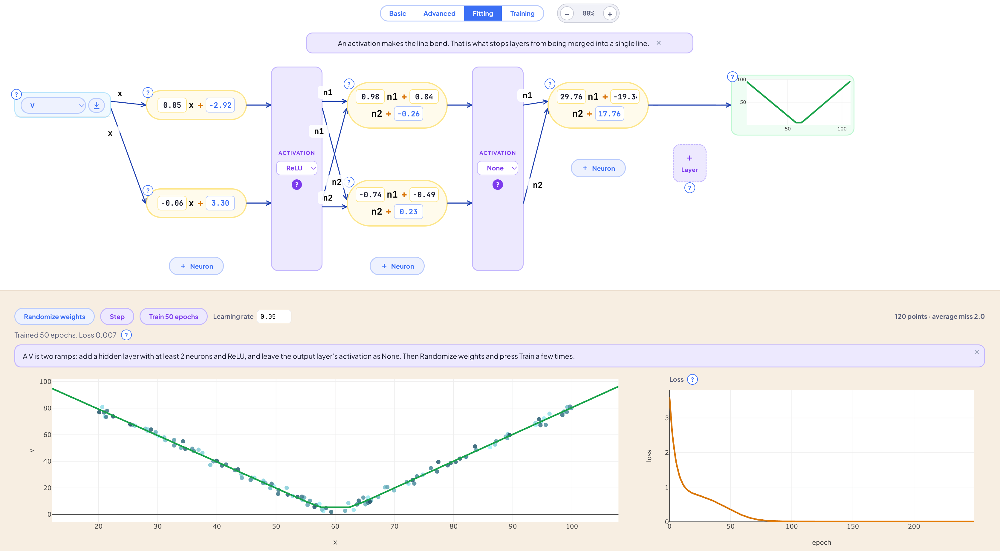
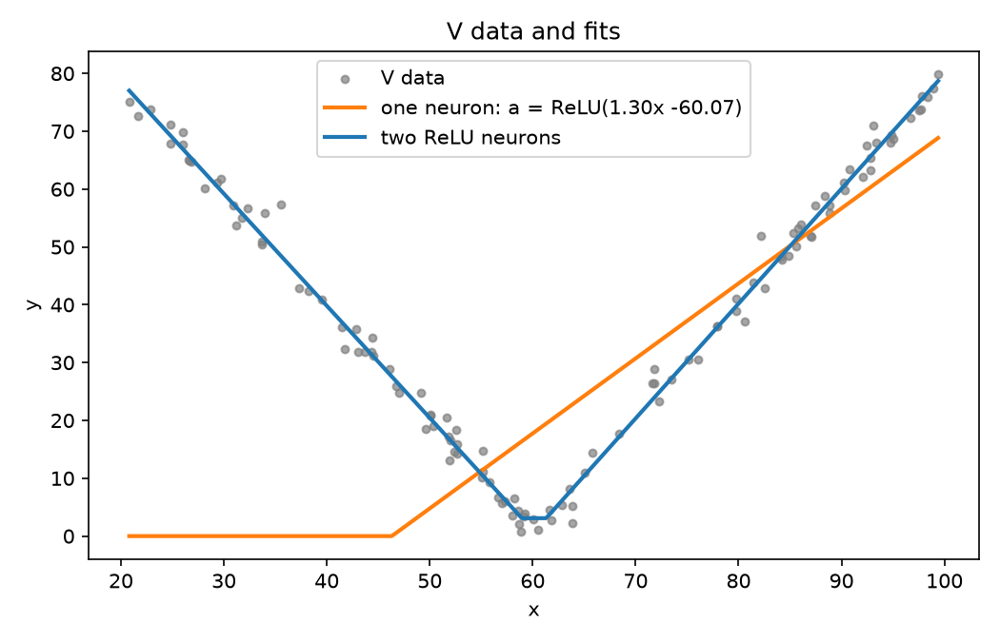
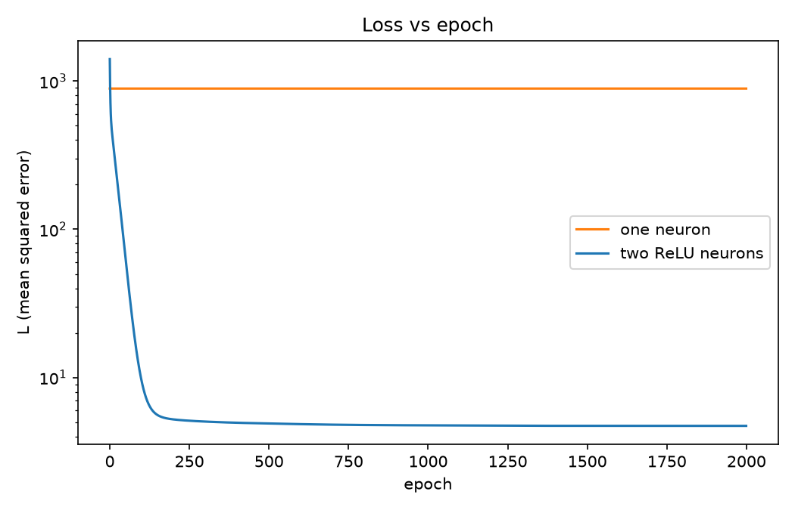

**The Imp-anne-etrable Safe** opens to a code shown with your fingers. It's a wooden box with a USB webcam looking down into it, an Arduino UNO Q as the brain, a push button to start and confirm entries, an MG995 servo that moves the latch, and the UNO Q's built-in LED matrix as the display. Press the button, hold up three numbers from 1 to 5 under the webcam, and confirm each one with another press. The matrix shows each digit as you enter it. If the code matches, it shows a check mark and the servo turns upright to unlock the latch; if not, it shows an X and stays locked.

The finger counting is done by a convolutional neural network (CNN) I built from scratch in PyTorch. I trained it on about 5,400 pictures of my own hand, then exported it to run on the UNO Q. The UNO Q's Linux side runs the camera, the network and the lock logic, while its microcontroller drives the button, LED matrix and servo.

## Starting by hand: fitting a V

Before the safe, I worked through the core idea by fitting V-shaped data with a single neuron, z = m·x + b, passed through ReLU. The loss is the mean squared error. Starting from a guess (m = 1.3, b = −60), each step uses the chain rule to find ∂L/∂m and ∂L/∂b, then moves both a small step downhill (learning rate 0.0001). I did the first five iterations in a spreadsheet, checked them against my Python code, and then ran many more.

One ReLU neuron can only bend once, so it fits just one arm of the V. Two ReLU neurons, one ramping up and one ramping down, summed by a linear output neuron, fit the whole shape:

ŷ = w₁·ReLU(m₁x + b₁) + w₂·ReLU(m₂x + b₂) + c

Two lessons carried over to the safe. Because the gradient for m is scaled by x (up to ~100 here), m's gradient is much larger than b's, which forces a small learning rate; rescaling x first puts both on similar scales. And if z < 0 for every point, the gradient is zero and the neuron stops learning, so the starting values matter. The CNN learns the same way (guess, measure the loss, backpropagate, update), just scaled up from 2 parameters to 99,222.

## The network

The camera picture is cropped to a red square and shrunk to 64×64 pixels in 3 colors (12,288 numbers). Each of the network's four convolutional layers slides small learned filters (5×5 in the first layer, 3×3 after that) across the image, producing feature maps that light up where a pattern such as a finger edge matches. Batch normalization keeps the values in a steady range, ReLU zeroes the negatives, and 2×2 max pooling halves the map size and makes the network tolerant of small shifts. The layers go from 16 maps of 32×32 to 128 maps of 8×8, building up from edges to finger parts to whole fingers. Global average pooling then reduces each map to one number, so the result depends on how much of each pattern is present, not where the hand is. A final layer turns those 128 numbers into 6 scores (0–5 fingers), and softmax converts them to probabilities.

I trained it with cross-entropy loss and Adam on 5,420 labeled pictures, with random rotations, shifts, mirroring and color changes so it can't simply memorize them. The stop-motion movie above walks through every step.

## The lock policy

The lock is a state machine that runs every camera frame. It starts **LOCKED** and ignores the camera until the button is pressed, which moves it to **ENTERING**. A frame's prediction only counts if the network is at least 80% confident and sees 1–5 fingers (0, a fist or an empty box, is ignored). When the same digit appears in at least 4 of the last 6 frames (about 0.4 s), it becomes the candidate and shows dimly on the LED matrix. Pressing the button accepts it and the digit turns bright; with no steady candidate, the press is ignored, so the user can adjust their hand until the preview is right.

After three digits, a match moves to **UNLOCKED** (check mark, servo to 90°); a mismatch shows an X for 3 seconds and relocks. Three wrong codes in a row trigger a 30-second **LOCKOUT**, taking more than 30 seconds on a digit cancels the entry, and pressing the button while unlocked locks the safe again.

## Laptop vs. UNO Q

I trained on my laptop (PyTorch, a few minutes), exported the model to ONNX, and verified that the board version gives the same answers as PyTorch on 300/300 test images. On the laptop, the whole lock ran in one Python program at about 30 frames per second. On the UNO Q the work is split: the Linux side runs the camera, the network (ONNX Runtime on the CPU, about 15 fps), the lock policy and a web page with the camera feed, while the microcontroller reads the button, draws on the LED matrix and generates the servo signal by hand, since its core has no Servo library. The two sides talk through the Bridge.

The biggest difference was the camera images. Even with the same webcam, the board's pictures came out bluer, grayer and framed slightly differently, so the laptop-trained model failed on the board: at first it read 3s as 4s and 5s, and later it read everything as 3. I fixed this by recording training pictures through the board's camera, adding random color shifts during training, and switching to global average pooling.

## Limitations

- **The network makes mistakes.** On recordings it never trained on, it was about 76% accurate, mostly confusing neighboring counts (3 vs. 4, 1 vs. 2). It only knows American-style finger counting.
- **It depends on my setup.** It was trained almost entirely on my own hands, in one box, with one camera and lighting.
- **The security is weak.** There are only 5³ = 125 codes, and the lockout only slows guessing (all 125 take about 22 minutes). Anyone watching can see the code, the web page's unlock buttons have no password, and the code is stored in plain text.
- **The physical lock is fragile.** The servo only holds the latch while powered, and the latch arm breaks fairly easily.
- **No undo.** A wrong digit means finishing the code and starting over.

## Reflection

Making the stop-motion movie and its voiceover is what taught me how a CNN works. I knew how convolution finds features by sliding a filter across an image, but not how the network uses them to decide: the filters are weights learned in training, like m and b in the V-fit, and the layers build individual edges up into finger shapes. I'm most proud of the lock policy: the user can adjust their hand until the preview shows the number they want before pressing the button, and the LED matrix shows the same information, so you don't need the computer to unlock the safe.

The hardest part was getting the model to recognize all six numbers equally well at once. Adding data to fix one number (like 3) would make another (like 4) start getting confused with its neighbors. My most spectacular failure was retraining with new pictures of 3 taken on the UNO Q, after which the model recognized nothing but 3 and 0, a major overcorrection: it had learned that the board's bluer lighting and framing meant "3". Recording every number again on the board, balancing how often each appeared in training, and redesigning the network (a fourth convolutional layer, batch normalization, global average pooling) made it work reliably.
