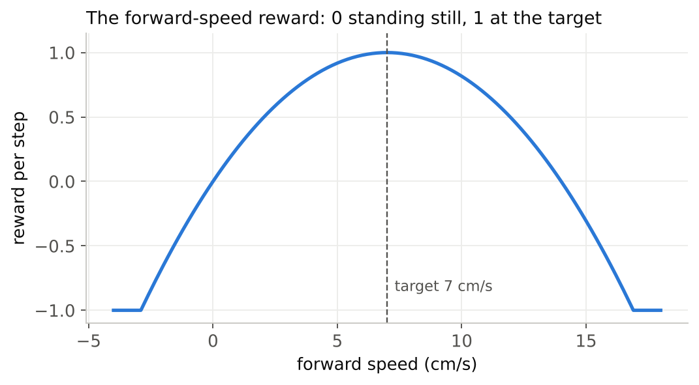
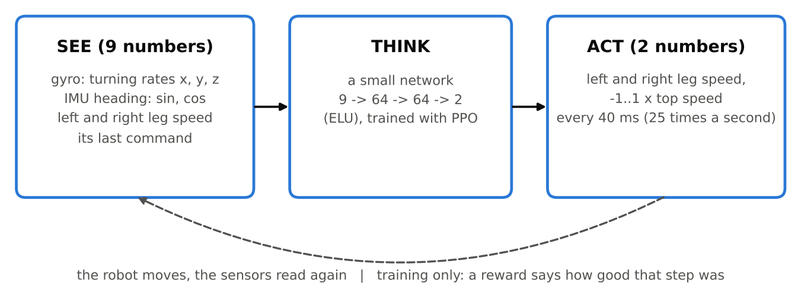
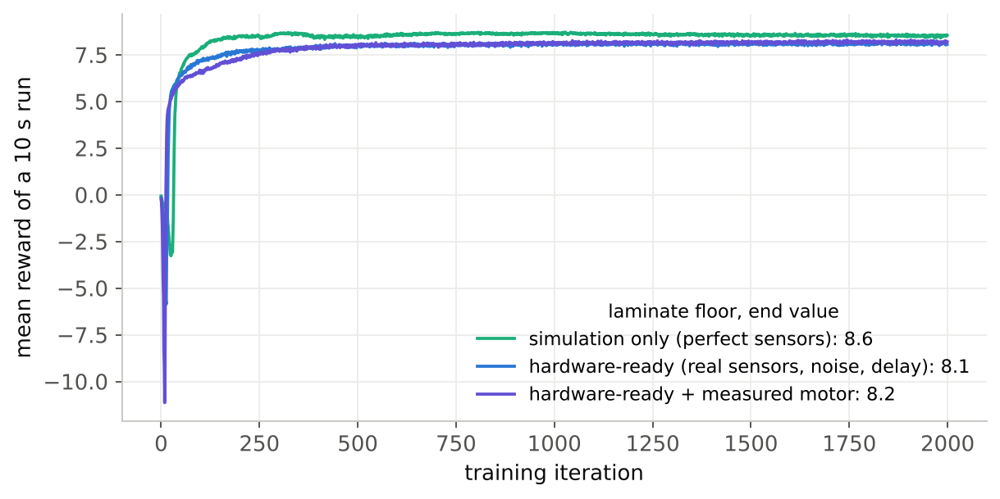
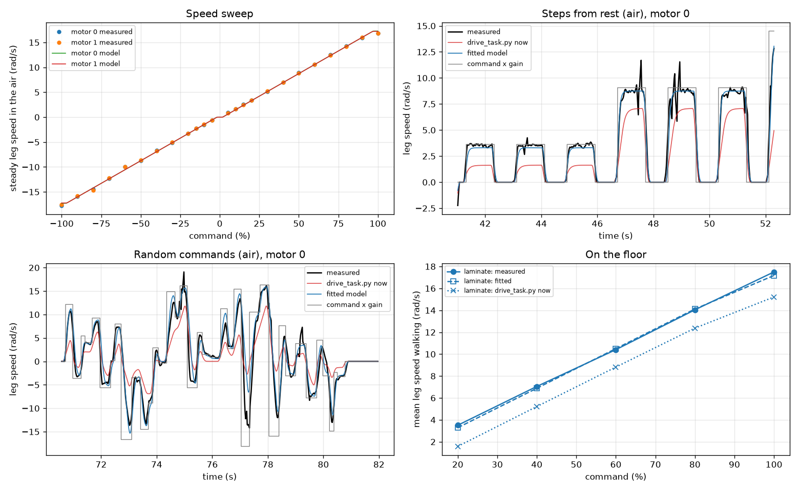
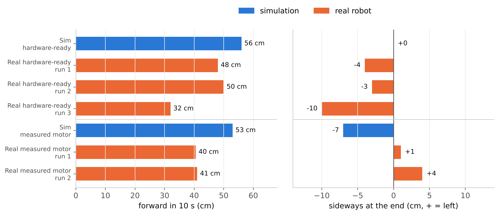
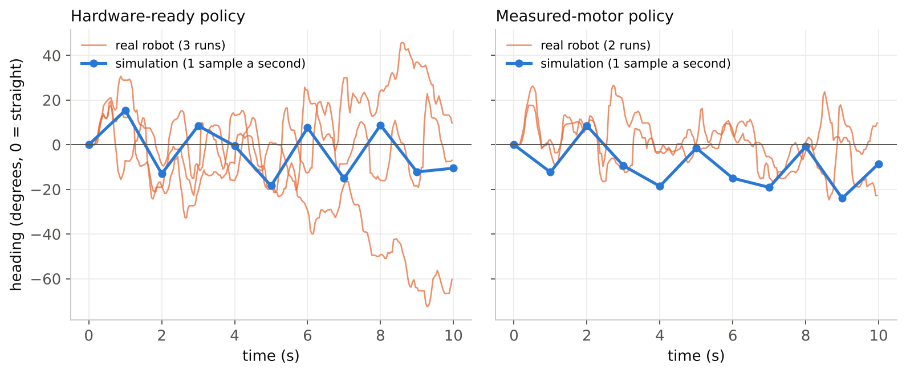

We built a LEGO robot from a LEGO Education Double Motor with a 1×8 Technic beam attached to each motor hub by two friction pegs. When the motors turn, the beams push the robot along in a wobbly "silly walk". Each leg pushes a little differently on every step, and some steps slip more than others, so the robot tends to drift and turn. The goal was to make it **walk in a straight line**.

We modeled the robot's parts (motor, hubs, legs and pins) in **Onshape**, with custom densities to match the measured masses, and turned the CAD into a **MuJoCo** model with onshape-to-robot. Then we used **mjlab** to train a small neural network (a policy) by reinforcement learning, on 4,096 simulated robots at once on the Tufts GPU cluster. Every 40 ms, the policy reads what the Double Motor can sense with its built-in IMU (turning rate, heading, how fast each leg is spinning, and its own last command) and picks a speed for each leg. We trained a separate policy for each of three floors: a default floor, slippery laminate, and grippier low-pile carpet.

To bring simulation and reality closer, we measured the real motor, fitted a motor model to the recordings, retrained the policy with it, and compared both policies on the real robot.

## The model

The robot has three kinds of parts: the body (the Double Motor, with two motor hubs, a battery and an IMU) and two legs, each a LEGO beam on a hub held by two pins. Total mass is **94.0 g**.

| Element | Mass (g) | Volume (cm³) | Density (g/cm³) |
|---|---|---|---|
| Motor (+ 2 hubs) | 88.5 | 100.18 | 0.885 |
| Leg (×2) | 2.8 | 2.83 | 0.992 |
| Pin (×4) | 0.189 | 0.129 | 1.47 |

Each leg is joined to the body with a revolute mate (`dof_left_wheel`, `dof_right_wheel`), and the exporter turns those into joints. Our task code turns the model to walk along +x, lets the body move freely, and gives it the floor's friction: **default** (1.0), **laminate** (0.3) and **carpet** (0.6). These are textbook values, not measured ones.

## The reward

**Goal:** walk along +x at a steady **7 cm/s** while staying on the line y = 0 and facing straight ahead. We picked 7 cm/s because the Silly Walker tops out near 7.5 cm/s. Each episode starts the robot up to ±23° off the line (so it has to learn to turn back), lasts 10 s, and ends early if the robot tips more than 60° or wanders more than 1.5 m off the line.

| Term | Formula | Weight | Pays for |
|---|---|---|---|
| Forward speed | max(1 − ((vₓ − 0.07)/0.07)², −1) | +1.0 | Walking forward at 7 cm/s |
| Stay on line | −y² | +1.0 | Staying near the start line |
| Face forward | −ψ² | +0.5 | Pointing along +x |
| Smooth commands | ‖aₜ − aₜ₋₁‖² | −0.05 | Not jerking the legs |

The forward-speed reward slopes everywhere, so a robot that starts out standing still always gets a hint of which way is better. A narrow bump around 7 cm/s would give it nothing to learn from. A perfect 10 s episode scores about 10; our trained policies score 8–9.

## The policy and training

The policy is a small neural network with two hidden layers of 64 neurons (ELU). Every 40 ms it reads **9 numbers** the real robot can measure and outputs **2**: a speed for each leg.

We trained with PPO in mjlab: each iteration, 4,096 simulated robots walk 24 steps and the policy is nudged toward actions that earned more reward. 2,000 iterations took about 10–15 minutes on a cluster GPU node. A critic network judges each situation during training and may see what the simulator knows; the policy only gets the real-sensor numbers.

We trained three versions, each building on the last: **simulation-only** (13 perfect numbers, 50 Hz), **hardware-ready** (9 real-sensor numbers at 25 Hz, what Bluetooth allows), and **measured-motor** (hardware-ready with the fitted motor model). For the hardware-ready policies, every simulated robot was a little different and its sensors imperfect: randomized sensor noise and delay (up to 40–80 ms), floor friction (±30% to 50–130%), motor strength (±15–30%), body mass, center of mass and starting leg angle.

The reward climbs within about 250 iterations and then levels off. The policies with real sensors end slightly lower (8.1 and 8.2) than the one with perfect sensors (8.6): they know less, so they can't hold the line quite as tightly.

## Sim to real

The trained policy is exported to ONNX and runs on a laptop, which talks to the Double Motor over Bluetooth. Every 40 ms it reads the IMU and leg encoders, builds the same 9 numbers as in simulation, runs the policy and sends the two leg speeds. A calibration first finds the gyro axes, leg directions and the legs' home position.

**Measuring the motor.** Our first simulated motor was a guess, so we measured the real one: about 85 s in the air (speed sweep, steps from rest, reversals, random commands) and 21 s walking on the floor. The real motor reaches **0.181 rad/s per %** up to a **top speed of 17.2 rad/s**; a leg first moves about **96 ms** after a command and reaches 63% of the new speed by **129 ms**. We replayed every recorded command in MuJoCo and tuned the simulated motor until its leg speeds matched.

| Motor setting | First guess | Fitted |
|---|---|---|
| Velocity gain | 0.05 N·m per rad/s | 0.048 |
| Torque limit | 0.2 N·m | 0.19 N·m |
| Joint friction | 0.1 N·m | 0.015 N·m |
| Armature (motor inertia) | 0.005 | 0.0024 |
| Command delay | none | 25–45 ms |
| Top speed | 10 rad/s | 17.2 rad/s |

The leg-speed error dropped from **2.97 to 1.16 rad/s** in the air and from **1.52 to 0.82 rad/s** on the floor. We first tested the fitting method on a fake motor with known values, and it recovered them closely.

**Real runs vs simulation.** We marked a start line on the floor, let the robot sit still for 1.5 s (to measure the gyro offset), let it walk for 10 s and measured the distance with a tape measure, using the laminate policies.

| Run | Forward in 10 s | Sideways at the end | Heading |
|---|---|---|---|
| Simulation, hardware-ready | 56 cm | 0 cm | −18 to +15° |
| Real, hardware-ready (3 runs) | 48, 50, 32 cm (mean 43) | −4, −3, −10 cm | −73 to +46° |
| Simulation, measured-motor | 53 cm | −7 cm | −24 to +9° |
| Real, measured-motor (2 runs) | 40.5, 41 cm (mean 41) | +1, +4 cm | −25 to +27° |

- **Distance:** the real robot walks about **77%** of the simulated distance with both policies.
- **Staying on the line:** every real run ended within **10 cm** of the line.
- **Heading:** with the measured motor, the real robot swings about ±25°, like the simulation. With the guessed motor it wobbled up to +46°, and in one run turned to −73°.

The policy never saw the real robot during training. Everything it knows came from simulation.

**Limitations.** The floor friction was guessed, not measured, and the real legs slip and bounce in ways the simulated contacts miss. Bluetooth readings arrive about every 30 ms, so the real policy can only act 25 times a second. And we had only five measured 10 s runs.

## Reflection

The simulation is a useful way to teach a robot a task without risking hardware damage, but there is a noticeable sim-to-real gap: variations in the floor and random slipping can significantly change the robot's direction. There are seemingly endless ways to try to close that gap (finding the real center of mass, slowing the hardware to prevent slipping, simulating grippy rubber feet, measuring the floors' friction), and it was hard to tell when more measurement stopped helping, since results with and without motor characterization didn't differ much.

We're most proud that the robot walked fairly straight on different floors, laminate and carpet. Our most spectacular failure: the original laminate policy turned the robot almost completely sideways (−73°) partway through a run and only went 0.32 m, compared to 0.56 m in simulation. The legs slipped randomly on the laminate, and the policy wasn't prepared for it.
