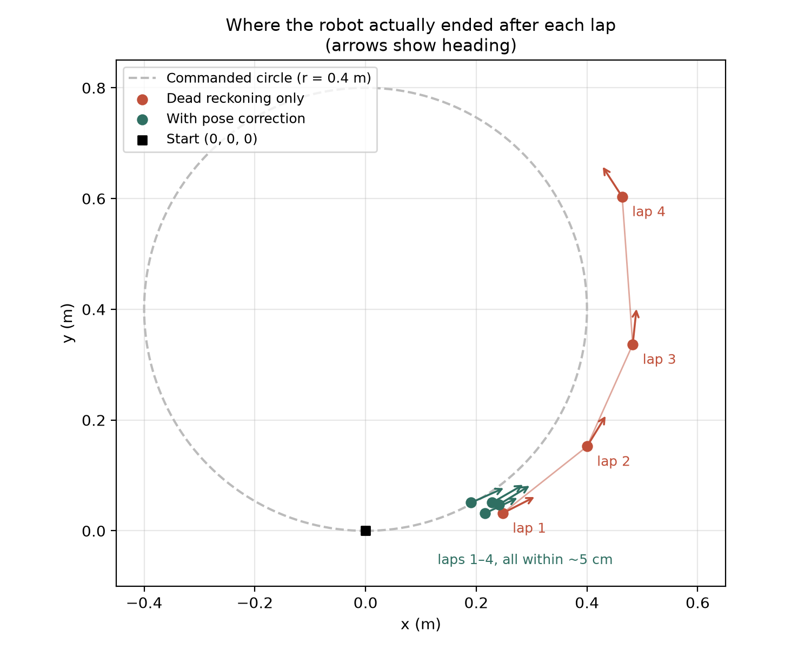

Over the semester, my partner Zack Siminoff and I have been building up a cruise controller for a small differential-drive robot, one lab at a time. The teaching team wrote the ROS 2 framework, drivers and logging. Our work was to model the hardware, write the control laws, and tune them against measured data.

## Lab 2: modeling a motor and balancing a pendulum

- **Motor characterization.** We swept the duty command from −1 to 1 and measured output speed. The response is close to linear, apart from a deadband of ±0.025 around zero, which we compensated for so the controller sees a linear plant.
- **System identification.** With the pendulum hanging down, we fit the linearized model φ̈ + bφ̇ + cφ = Ku from both a step response and a sinusoidal frequency sweep. The two fits disagreed widely (K ≈ 2.5 from the steps vs. ≈ 54 from the sweep). The free responses didn't settle to zero, so we used the frequency-response fit. The measured resonance peak was also sharper than the model predicts, because constant damping doesn't capture what happens near resonance. Other likely causes were large angles beyond the small-angle approximation and parts that worked loose during testing.
- **PD balancing.** Linearizing about the upright position flips the sign of the c term, so the open loop is unstable. Using the frequency-response model, we placed the closed-loop poles at ζ = 1 and ω = 15 rad/s and solved for the PD gains. The controller balanced the pendulum upright (video below).

## Lab 3: wheel-speed PI control with anti-windup

- **P only** left a large steady-state error: the wheel settled near 3.3 rad/s against a 2π rad/s command.
- **Adding integral action** brought the wheel to the setpoint in about 2 s.
- **Windup.** When we held the wheel still, the integrator kept growing, so the unsaturated command climbed to 2.5 while the actual output was capped at 1.0. On release, the wheel overshot to ~57 rad/s. We added conditional integration, which pauses the integrator whenever the output is saturated and the error would push it further. That cut the overshoot roughly in half. Debugging the windup plot also showed that our duty command had the wrong sign.

## Lab 4: building SparcBot

We assembled the robot from two of the motor, encoder and driver units used in the earlier labs, with a Raspberry Pi, a breadboard and a caster. Then we drove it with open-loop PWM from the keyboard. Without feedback it drifted off straight lines and didn't spin cleanly in place (video below), which set up the need for closed-loop speed control.

## Lab 5: cruise control on SparcBot

- **Controller.** Each wheel runs feedforward on the target velocity, plus P and I feedback on a lightly filtered velocity error, plus breakaway compensation that adds a fixed offset in the direction of motion to overcome static friction.
- **Step tests.** Spinning-in-place and forward/backward steps track the command within the ±⅓ band and the 0.5 s settling target. There is some overshoot on the largest step.
- **Changing slope.** At a constant commanded speed, the logged wheel velocities dip as the front wheels, then the rear wheel, reach the ramp, and again at the start of the incline, where the controller recovers more slowly. The noise in the measured velocity turned out to come from the sensing, not from our gains.

## Lab 6: tracking a circle, and why dead reckoning drifts

With wheel speeds under control, the next layer is a **full-state feedback** controller that generates v and ω to make SparcBot drive a circle (r = 0.4 m at vd = 0.2 m/s, ωd = 0.5 rad/s, one lap every 4π s). The robot estimates its pose (x, y, θ) by integrating its encoder wheel speeds, known as dead reckoning. The tracking error is expressed in the robot's frame (forward, lateral and heading error), and linearizing the unicycle model about the circle gives constant error dynamics ė = A e + B δu. The system is reachable, so the controller u = −K e + [vd ωd]ᵀ can place the closed-loop poles anywhere. Using gains k₁ = −3 (forward error → v) and k₅ = −8.75, k₆ = −3 (lateral and heading error → ω) places them at −1, −2 and −3.

We drove four laps back to back without moving the robot, measuring where it actually ended after each one, in two experiments:

- **Dead reckoning only.** The only measurements are wheel speeds, so C = 0 and the observability matrix Wo = [C; CA; CA²] has **rank 0**: nothing the robot measures reveals its pose error. Every lap started from the previous lap's erroneous endpoint, so the error accumulated: the robot ended 25 cm from the start after lap 1 and 76 cm away after lap 4, with its heading off by 123°.
- **With pose correction.** After each lap we measured the robot's real pose and sent it to the odometry (a `set_pose` call). Measuring x, y and θ directly adds an identity block to C, and Wo has **full rank (3)**, so the system becomes observable. The endpoints stayed within about 5 cm of each other across all four laps, with headings of 24–32°.

In both experiments the first lap ended about 25 cm from the start, so a single lap already picks up noticeable error. The difference is that correction stops it from compounding. Sources of error we identified: when the car accelerates it tips forward, lifting the rear caster and unevenly loading the front wheels, which causes slip that the encoders count as motion. It also jitters and creeps after stopping, before we could stop the driver, so the pose changed slightly between the lap's end and our measurement. Smaller contributions come from wheel-radius and base-width errors, encoder noise, mismatched left and right motors, and our own tape-measure readings.

The remaining labs build on this controller. I'll add them here as the course goes on.
