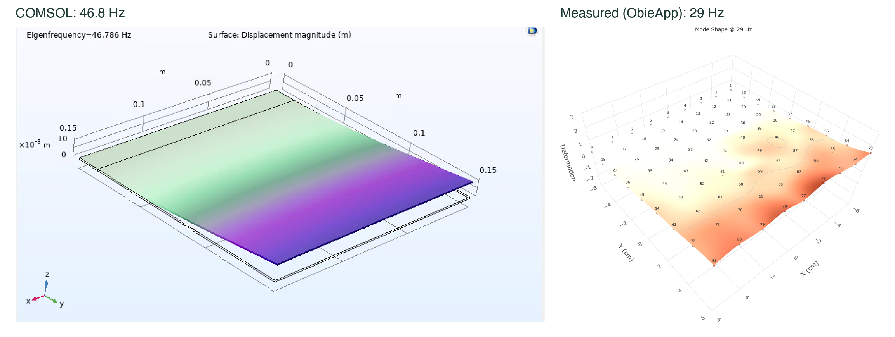
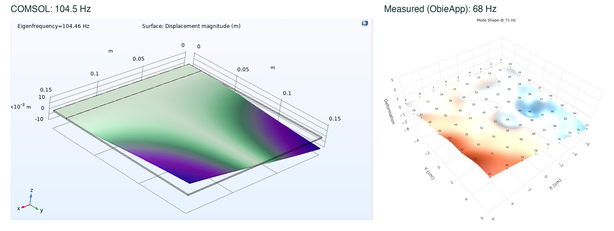
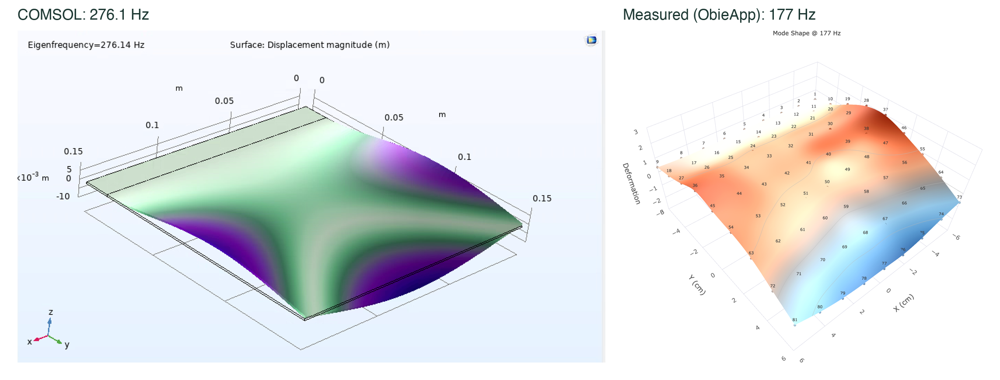
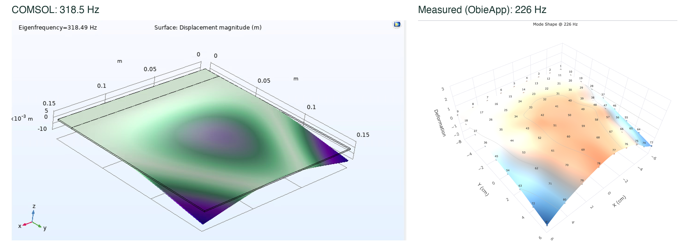
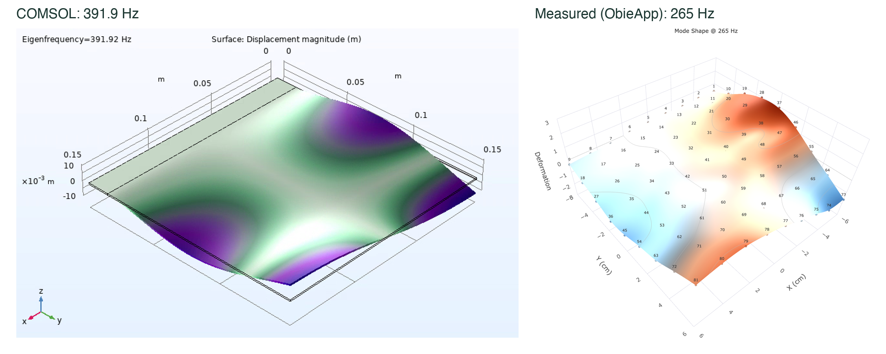
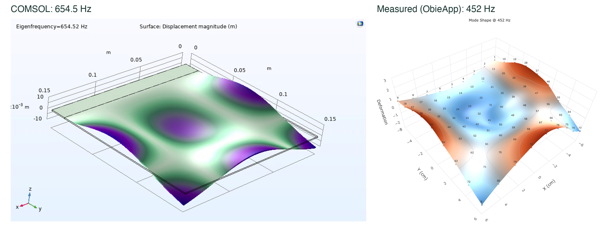

This summer I worked as a research intern at the Tufts Center for Engineering Education and Outreach on **ObieApp**, an in-house tool for measuring and visualizing how violins vibrate. Violin plates are tuned by how they vibrate, and modal analysis (tapping a plate at a grid of points and measuring its frequency response) shows which frequencies the plate resonates at and what shape it moves in at each one. My work was building features that make those measurements easier to collect and analyze, and checking whether the results can be trusted.

## What I built

- **Stencil Builder.** A tool for laying out the grid of tap points: a node grid you can scale, stretch, rotate and drag, with each node's physical position saved in millimeters. The stencil is **projected onto the instrument**, highlighting the next point to tap and advancing automatically as each hit is recorded.
- **Acquisition and mode shapes.** I connected stencils to data acquisition (so every measurement carries its physical coordinates) and refactored the mode-shape viewer to read saved runs instead of duplicating acquisition. I also added a contour view, an orientation cube, animated mode export, and an FRF view with averaging and a peak finder.
- **Circle Fit tool.** A new tool that extracts modal parameters from a measured frequency response. It fits a circle to each resonance in the Nyquist plane (Kåsa least-squares), takes the natural frequency at the maximum sweep rate, and computes the loss factor and modal constant, with residual compensation and 82 passing unit tests. I've tested it on the cantilevered reference plates. Validating those measurements is still an open problem (see below).
- **Measurements** on a violin top (a 4 × 4 grid on the lower bout), a free aluminum plate, a carbon-fiber strip, a spruce plate, and a cantilevered aluminum plate, with an accelerometer and impact hammer through IEPE signal conditioners.

## Validating the data

The most important question was whether the measurements are right. I built COMSOL models of the reference plates and, for the cantilevered aluminum plate (1 mm thick, 135 × 150 mm free span), also calculated the first modes by hand using the Ritz method.

| Mode | Calculated (Hz) | COMSOL (Hz) | Measured (Hz) |
|---|---|---|---|
| 1st bending | 47.0 | 46.8 | 29 |
| 1st torsion | 109.5 | 104.5 | 68 |
| 2nd bending | 287.5 | 276.1 | 177 |
| Mixed | 338.9 | 318.5 | 226 |
| 2nd torsion | 413.5 | 391.9 | 265 |
| 3rd bending | 727.1 | 654.5 | 452 |

The calculation and COMSOL agree closely, and the measured **mode shapes match and come in the right order**, but every measured frequency is about **0.62× the prediction**. Moving the accelerometer between three positions didn't change the results, and striking more lightly and consistently improved coherence. Candidate causes I identified include the clamp's boundary compliance, a fixed 0.3 s acquisition window that truncates the lightly damped ring-down, and undetected double hits. Resolving this offset is ongoing, and it motivated the Circle Fit tool and automated, repeatable impact testing with a robot arm.

**COMSOL vs. measured mode shapes.** Each pair shows the same mode, with COMSOL on the left and my ObieApp measurement on the right:

## Other challenges

- **Coherence on the violin** dropped at anti-resonances and above ~4 kHz. I traced it to low signal-to-noise at anti-resonances, hammer-tip roll-off and room noise.
- **Software reliability.** The original mode-shape workflow froze after the third node. Moving all acquisition into one module fixed it structurally. The projected stencil ran one node ahead until I synced it to the recorded hit count in each file's metadata.
- **Fixtures.** The hammer rig blocked the projector, so I tested projector mounts, including a mirror setup, and designed small 3D-printed holders for the test station.

I also made two small browser tools for quick audio checks: a live [frequency detector](https://github.com/annejumper/FrequencyDetector) and a [spectrogram viewer](https://github.com/annejumper/spectogram).
